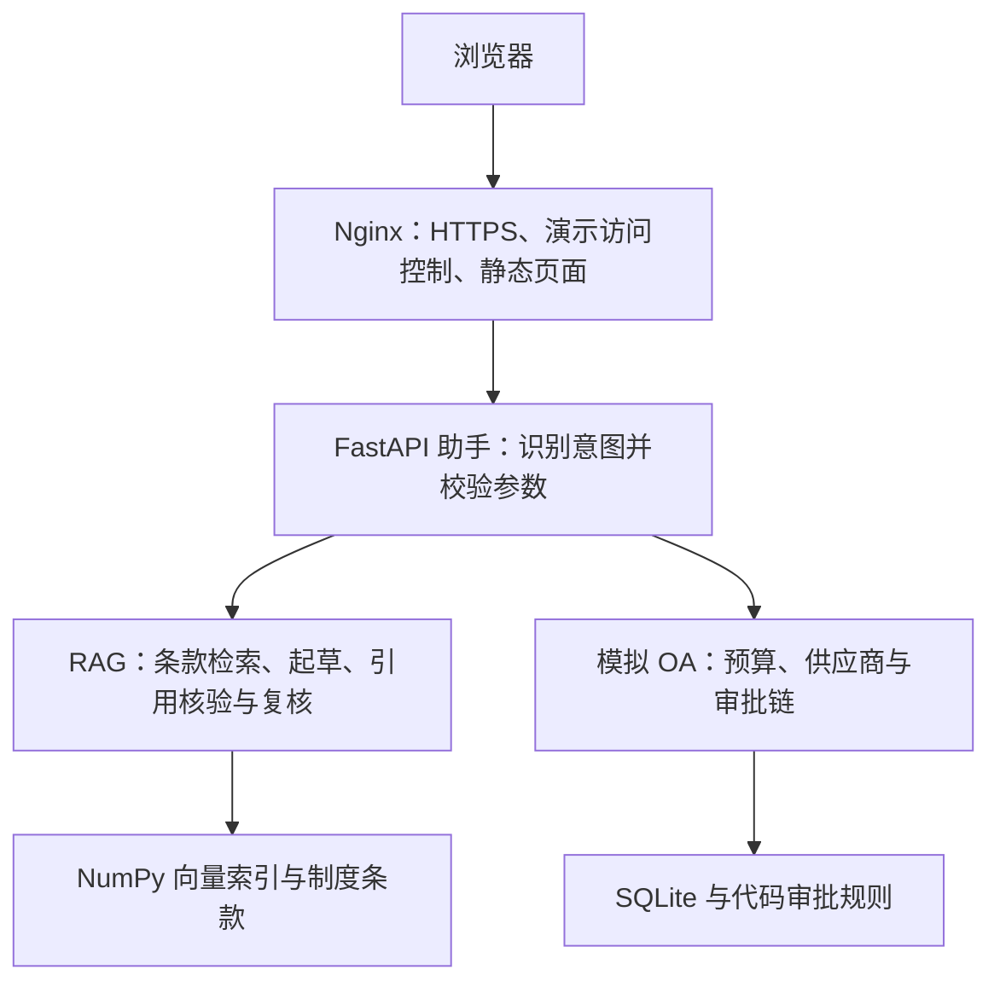

# 技术说明与本地运行

[返回项目首页](../README.md)

本文件面向需要查看实现或复现项目的读者。项目介绍、线上入口与当前评测结果见首页。

## 架构与职责



- `oa/`：预算金额以整数分存储，使用 Decimal 换算；接口对外返回金额字符串。审批规则版本为 demo-v1，金额小于 5000 元由部门主管审批，5000 元至不足 20000 元增加财务，20000 元及以上增加总经理。
- `rag/`：依据 `data/policies/manifest.json` 加载 50 份制度，按“第 X 条”拆分为 150 条。向量归一化后进行余弦排序，检索 Top-5；索引记录模型、维度和语料指纹，拒绝使用不匹配的旧索引。未使用 LangChain 或 LlamaIndex。
- `assistant/`：使用 Function Calling 识别一个动作；参数必须来自用户原文，具体金额经代码归一化与校验后调用 OA。预算、供应商、审批查询结果通过固定模板输出，不再交给模型改写。

RAG 回答需携带证据。程序检查条款 ID 与引文，模型再检查结论支持关系和适用条件。模型复核可能出错，仍需人工评测。

## 本地安装

以下示例使用 Windows PowerShell，先安装 Python 3.12 与 Git。

```powershell
git clone https://github.com/YuwuShan/enterprise-policy-ai-assistant.git
Set-Location enterprise-policy-ai-assistant
py -3.12 -m venv .venv
.\.venv\Scripts\python.exe -m pip install -r requirements.txt
```

首次配置时，将 `.env.example` 复制为 `.env`，填写：

| 变量 | 用途 |
|---|---|
| DASHSCOPE_API_KEY | 模型服务密钥 |
| DASHSCOPE_BASE_URL | 模型 API 地址 |
| CHAT_MODEL | 对话模型标识 |
| EMBEDDING_MODEL | 向量化模型标识 |

`.env` 不提交 Git。当前 `.env.example` 的向量模型为 text-embedding-v3；历史开发索引使用过 text-embedding-v4。使用已有索引时必须匹配建索引所用模型；首次运行可选定可用模型后自行建索引。模型或制度变化后需重新建索引，不能只修改配置继续使用旧向量。

## 本地运行服务

在项目根目录初始化模拟数据库、构建索引。建索引会调用外部向量化 API。

```powershell
.\.venv\Scripts\python.exe -m oa.db
.\.venv\Scripts\python.exe -m rag.build_index
```

分别打开两个 PowerShell 终端，进入项目根目录运行：

```powershell
# 终端一：模拟 OA
.\.venv\Scripts\python.exe -m uvicorn oa.main:app --reload --host 127.0.0.1 --port 8001
```

```powershell
# 终端二：助手
.\.venv\Scripts\python.exe -m uvicorn assistant.main:app --reload --host 127.0.0.1 --port 8000
```

通过 `http://127.0.0.1:8000/docs` 查看并调用 `/ask`。预算种子数据使用月份 `2026-10`；预算查询写明月份，避免“本月”随时间变化而与种子数据不一致。

## Docker 与云端配置

模型配置和本地索引准备好、Docker 引擎已运行后：

```powershell
.\.venv\Scripts\python.exe deploy/check_environment.py
docker compose up -d --build
docker compose ps
```

本地 Compose 仅通过 Nginx 发布 `127.0.0.1:8081`，可访问 `http://127.0.0.1:8081/docs`。云端静态演示页由云端 Nginx 配置提供，本地默认反向代理配置不提供相同首页。

云端使用 `compose.yaml` 与 `compose.cloud.yaml` 合并，发布 80 / 443。首次部署还需生成域名配置、创建演示账号并申请证书，不能直接套用本地配置。服务器准备完成后通过 `sudo bash deploy/cloud.sh ...` 操作合并配置。

- OA 数据使用命名卷；制度与索引以只读目录挂载。
- `assistant` 通过 `http://oa:8001` 访问 OA；容器内的 127.0.0.1 指向自身。
- OA 健康检查访问实际数据库接口；助手 `/health` 仅为存活检查，不证明模型或索引可用。
- `deploy/renew-hook.sh` 提供证书续期后的 Nginx 检查与重载操作。
- `deploy/backup.sh` 使用 SQLite 备份接口生成快照；`restore_check.py` 将备份恢复到独立文件检查，不覆盖在线库。

部署完成与恢复成功需以实际运行记录为准，脚本存在不代表这些步骤已经通过验收。参见 [部署验收清单](day7-acceptance.md) 与 [交付说明](project-handover.md)。

## 测试入口

| 命令 | 范围 | 运行条件 |
|---|---|---|
| `python -m quality.offline` | Day 3 离线检查与 Day 4/5/8 单元测试 | 安装依赖；不需要模型密钥或运行中的 OA |
| `python check_day2.py` | OA HTTP 接口与审批边界 | 本地 OA 已启动 |
| `python check_day5_http.py` | 带模拟模型路由的 HTTP 集成检查 | 参照脚本的隔离环境设置 |
| `python -m rag.evaluate` | 10 题历史开发集检索命中 | 模型配置与索引就绪；调用向量化 API |
| `python -m quality.evaluate run` | 24 题定义与预期条款检查 | 不请求线上站点 |
| `python -m quality.evaluate run --live --user demo` | HTTPS 真实问答评测 | 演示账号；可能产生模型费用 |
| `python -m quality.evaluate review <运行目录>` | 人工逐题复核 | 已生成本轮评测结果 |

CI 工作流见 [.github/workflows/ci.yml](../.github/workflows/ci.yml)，运行统一的离线入口。测试进程禁用 `.env` 加载并拦截网络连接。mock 用例检查程序流程，不能代替真实模型评测。

Day 8 每轮报告保存在 `data/index/day8/<运行目录>/`，包含用例快照、结果、人工标注与汇总，避免覆盖旧记录。旧 Day 4/5 脚本仍使用固定报告文件名，不应把它们与新流程混为一谈。

## 已知限制与后续改进

1. 最近一轮制度问答中 7/8 返回 `502 invalid_model_output`。当前错误缺少路由、起草、复核阶段标记，无法仅据此确认根因；优先完善阶段日志并复测。
2. 仅支持整理后的 Markdown、单轮单动作、模拟人民币业务。无会话记忆，不做汇率换算，不写入审批或扣减预算。
3. 只校验条款正文引文；仅存在于 scope 元数据或前言的信息可能无法被引用。
4. 供应商名称与品类存在自然语言歧义，应明确产品约定或追问，不能只靠返回数量判断参数正确。
5. manifest 未收录的旧制度文件仍在目录中，部分内容互相冲突。当前加载器以 manifest 为准；不要未经审核改成扫描全部 Markdown。
6. 演示入口使用 Basic Auth，无企业身份与角色权限体系；没有生产并发或可用性指标。

历史 10 题检索开发集曾得到 Hit@1=9/10、Hit@5=10/10，仅说明预期条款的检索位置，不能转换为问答正确率。当前端到端结果以 [Day 8 记录](day8-quality.md) 为准。
